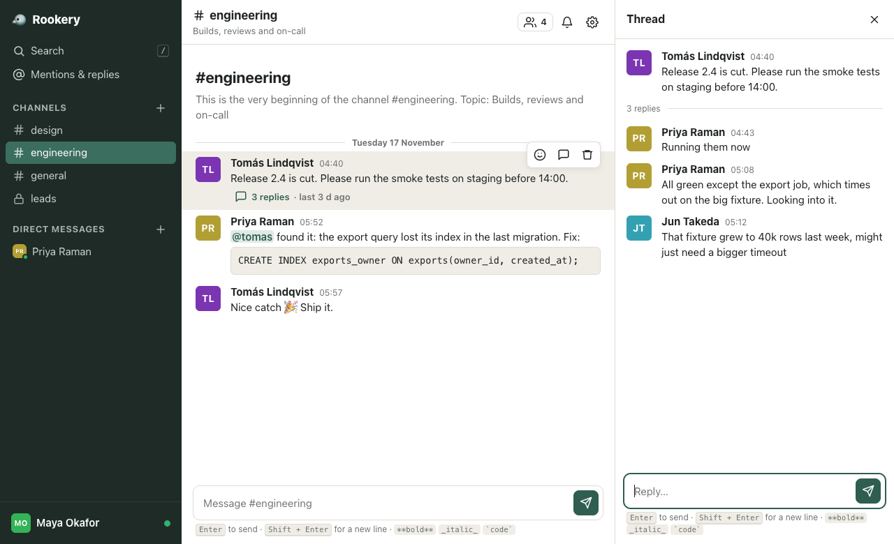
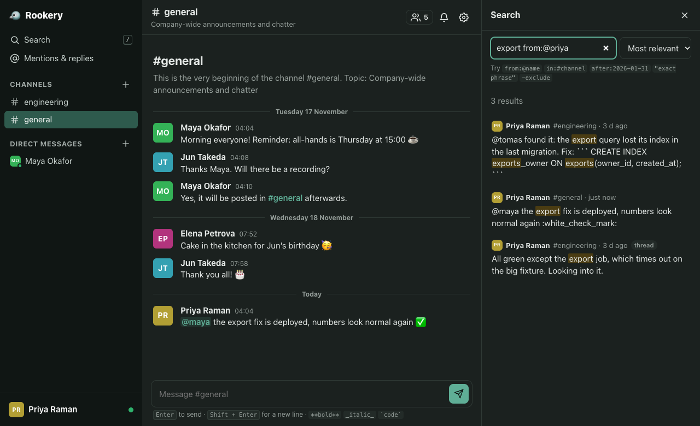
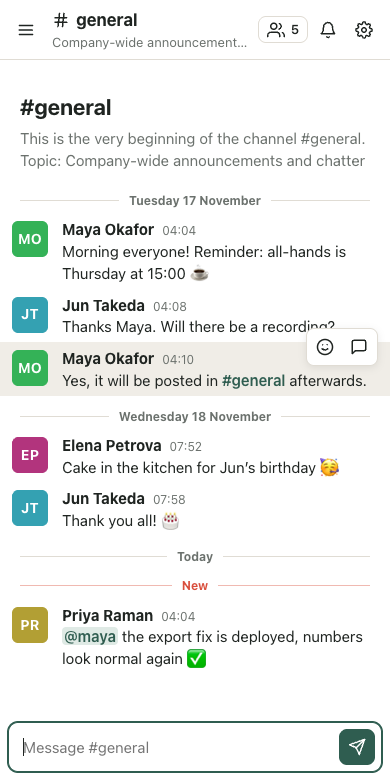

# Rookery

A self-hosted team chat server. Channels, direct messages, threads,
reactions, full-text search and notifications run in one Node.js process
with a single SQLite file. There's nothing else to install: no Redis, no
separate search engine, no build step for the web client.



| | |
| --- | --- |
|  |  |

## Features

- **Accounts.** Passwords are hashed with scrypt. Sessions use HttpOnly
  cookies, and logins are throttled. The first account becomes the admin,
  who can close sign-up, deactivate people and promote other admins.
- **Channels.** Public channels can be browsed, read without joining, and
  joined. Private channels are invite-only and invisible to everyone else.
  Owners can rename, archive and remove members. Everyone is in `#general`.
- **Direct messages.** One-to-one or groups of up to nine people. The same
  set of people always gets the same conversation back.
- **Threads.** Threads are one level deep, with a reply count on the first
  message. Everyone who joins a thread follows it.
- **Messages.** Basic formatting (bold, italics, strikethrough, inline code
  and code blocks, quotes), links, `@mentions`, `#channel` links and
  `:shortcodes:`. Authors can edit for 24 hours. Authors and channel owners
  can delete.
- **Reactions** with any emoji.
- **Real-time delivery** over WebSocket: messages, edits, reactions,
  typing indicators, presence and membership changes. After a dropped
  connection, the client reconnects and fetches what it missed.
- **Unread state.** Read markers are kept per channel and synced across
  tabs. Unread and mention counts show in the sidebar and the page title.
- **Notifications** for `@name`, `@channel`/`@everyone`, `@here` (online
  members only), direct messages and thread replies. Muting a channel
  silences everything except your own name. Notifications appear in a
  panel, as toasts, and as desktop notifications when the tab is hidden.
- **Search.** SQLite FTS5 with stemming and accent folding. Supports
  phrases, `-exclusions` and prefix matching, plus `from:@user`,
  `in:#channel`, `before:`/`after:`/`on:` dates, `is:thread`, `is:dm`,
  `has:reaction` and `has:link`. Results only include channels you can
  read.
- **Security.** Strict Content-Security-Policy, origin checks on every
  write and on the WebSocket, rate limits on sends, searches and sign-ups,
  and HTML escaping before any formatting is applied.
- **Admin CLI** for online backups, password resets and a demo dataset.

## Running

Requires **Node.js 22.13 or newer**. Rookery uses the built-in
`node:sqlite` module.

```sh
npm install
npm start                  # http://127.0.0.1:3000
```

Open the page and create the first account; it becomes the admin. To look
around with sample data instead:

```sh
npm run cli -- demo        # five people, a few channels and some history
npm start                  # sign in as maya / rookery-demo
```

### Configuration

All settings are environment variables:

| Variable | Default | Meaning |
| --- | --- | --- |
| `PORT` | `3000` | Port to listen on |
| `HOST` | `127.0.0.1` | Interface to bind; use `0.0.0.0` to accept outside connections |
| `ROOKERY_DB` | `data/rookery.db` | SQLite database file (created if missing) |
| `ROOKERY_SECURE_COOKIES` | off | Set when served over HTTPS: adds `Secure` to cookies and sends HSTS |
| `ROOKERY_TRUST_PROXY` | off | Use `X-Forwarded-For` for rate limits when behind a reverse proxy |
| `ROOKERY_ACCESS_LOG` | off | Log one line per request |

To run behind a reverse proxy (nginx, Caddy), forward `/ws` with the
`Upgrade` and `Connection` headers and keep the `Host` header. The origin
check compares the browser's `Origin` against `Host`.

### Admin CLI

```sh
npm run cli -- backup backups/rookery-2026-11-20.db   # safe while the server runs
npm run cli -- stats
npm run cli -- user create alice --admin             # prints a generated password
npm run cli -- user reset-password alice             # also signs alice out everywhere
npm run cli -- user promote alice
npm run cli -- user deactivate alice
```

Set `ROOKERY_PASSWORD` to choose the password instead of having one
generated.

## Development

```sh
npm run dev      # restarts on changes
npm test         # node:test, 80+ tests, no browser needed
npm run lint
```

The tests start real servers on random ports with in-memory databases, and
drive them over HTTP and WebSocket. The client's store and message
formatter are plain modules, so they're tested in Node as well.

### Layout

```
src/server/
  main.js          process entry: configuration, listen, shutdown
  app.js           HTTP server, security headers, per-request auth, wiring
  db.js            SQLite connection and append-only migrations
  auth.js          password hashing, sessions, cookies, origin check, throttle
  realtime.js      WebSocket hub: fan-out, watching, typing, presence
  notify.js        mention parsing and notification rules
  search.js        query parser and FTS5 search
  ratelimit.js     token buckets
  model/           channels, messages, reactions
  routes/          REST endpoints
src/cli.js         admin commands
public/            the web client (ES modules, no build)
  js/lib/          store and formatter, shared with the tests
  js/views/        sidebar, channel, thread and search panes, dialogs
tests/             node:test suites
docs/api.md        HTTP and WebSocket reference
```

Routes emit domain events (`messageCreated`, `memberAdded`, ...) on one
emitter. The WebSocket hub and the notifier subscribe to those events, so
REST handlers never need to know who is connected.

See [docs/api.md](docs/api.md) for the HTTP and WebSocket API.

## License

MIT. See [LICENSE](LICENSE).
